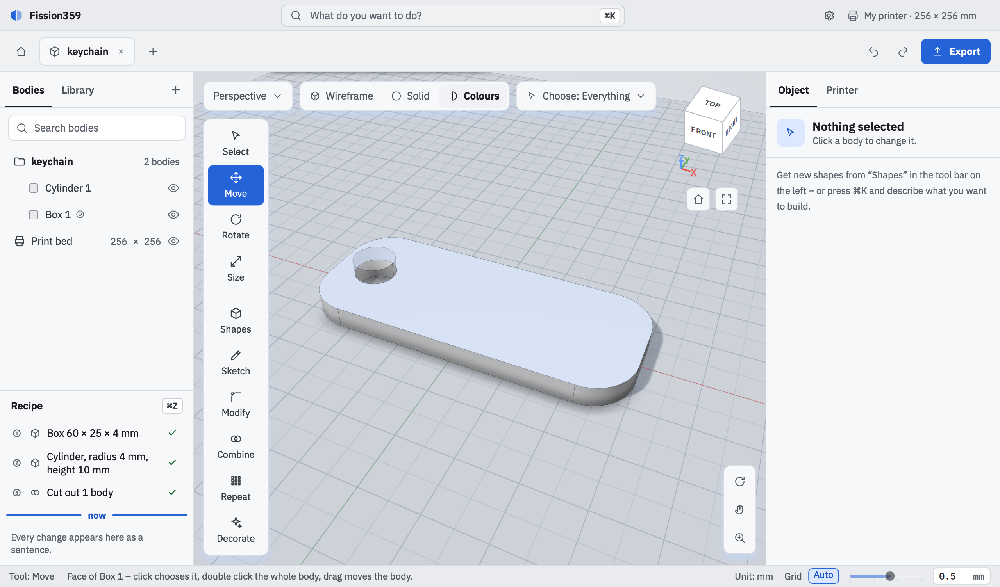
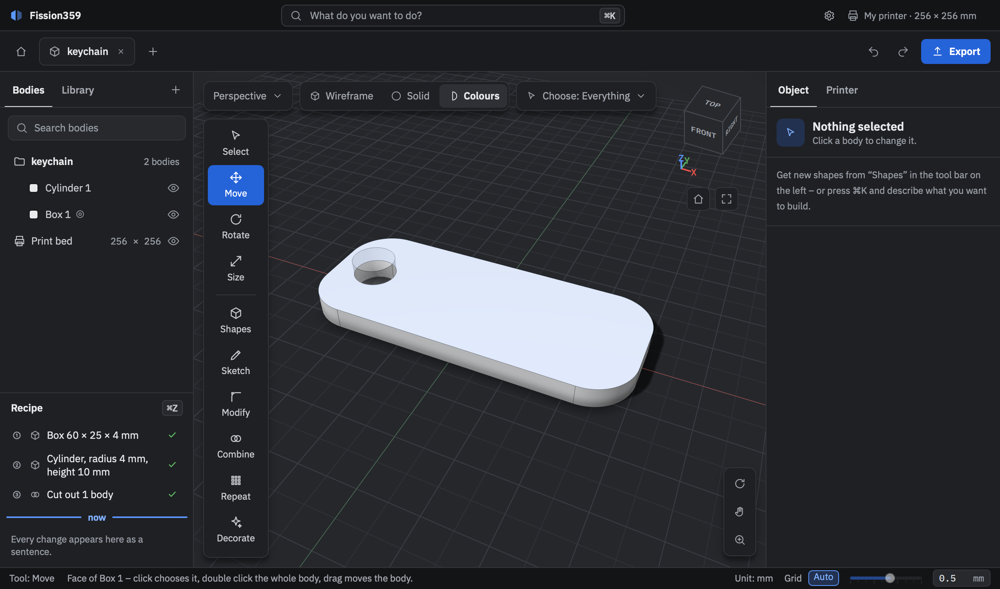

# Fission359

[](https://github.com/SloppyHenry/Fission359/actions/workflows/ci.yml)

**A native 3D construction program for macOS (Apple Silicon) and Linux: as easy as Tinkercad, as precise as Fusion.**
Build functional parts and decorations, mainly for FDM 3D printing. No browser, no account, no cloud.

<p align="center">
  
  
</p>

- **Grab, don't fill in dialogs:** every operation has handles in the 3D view; every number can be typed instead.
- **Everything stays editable:** each change is an undoable step in the recipe on the right.
- **Holes just work:** a hole cuts live and stays grabbable as a ghost shape.
- **Round stays round:** exact geometry (OpenCASCADE), export deviation of at most 0.01 mm.
- **German and English** user interface, switchable without a restart.

**Status:** early alpha (phase 1: place, size, move, rotate and combine shapes, text, save, 3MF/STL export).
Roadmap: [docs/04-roadmap.md](docs/04-roadmap.md) (German).

## Try it

Download the latest build from [Releases](https://github.com/SloppyHenry/Fission359/releases): `.dmg` for macOS, `.AppImage`
or `.flatpak` for Linux (Ubuntu 24.04 or newer). The builds are unsigned, so macOS asks once for permission:
see [docs/paketierung.md](docs/paketierung.md).

## Build from source

```sh
git clone https://github.com/SloppyHenry/Fission359.git && cd Fission359
scripts/setup          # checks and installs prerequisites (asks first)
scripts/run --release  # builds (first time: 15-30 min) and starts
scripts/test           # runs all tests
```

Needs Xcode and [Homebrew](https://brew.sh) on macOS, or Ubuntu/Debian x86_64. Something fails? `scripts/setup --check`;
build logs are in `build/*.log`.

## Contributing

C++20, Qt 6 (Qt Quick), OpenCASCADE, Manifold, PlaneGCS; CMake, Ninja and vcpkg. Layers: `src/core` (no Qt) → `geometry` →
`features` → `ui`; violations fail the build. Please read [CONTRIBUTING.md](CONTRIBUTING.md) and the
[Code of Conduct](CODE_OF_CONDUCT.md). The project documentation under [docs/](docs/README.md) is in German.

## License

[GPL-3.0-or-later](LICENSE). Third-party libraries: [THIRD_PARTY_NOTICES.md](THIRD_PARTY_NOTICES.md).
