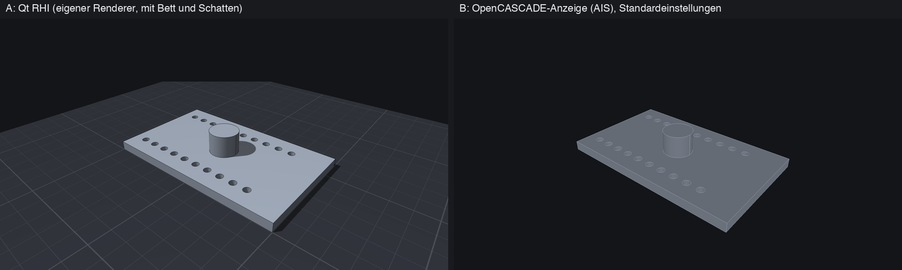
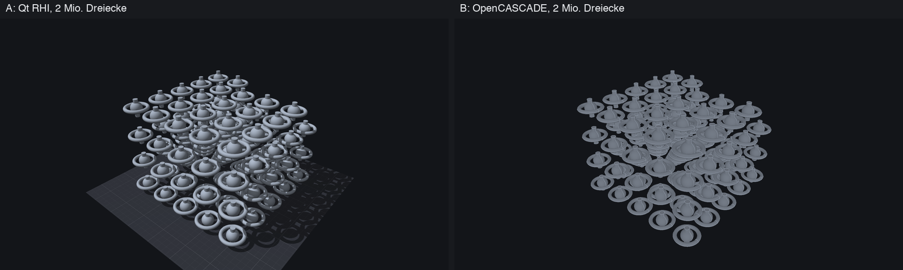

# Spike AP-0.4: Viewport-Technologie

**Stand:** 13.10.2026 · **Empfehlung:** Prototyp A (eigener Renderer auf Qt RHI), siehe
[ADR-0002](../adr/0002-viewport-technologie.md). Die Entscheidung trifft der Product Owner.

Gefragt war: Womit zeichnen wir die 3D-Ansicht? Zwei Prototypen zeigen dieselben OpenCASCADE-Körper
und wurden mit denselben Szenen gemessen:

| | Prototyp A | Prototyp B |
|---|---|---|
| Technik | eigener Renderer auf **Qt RHI** (Metal, Vulkan, OpenGL, D3D) | **OpenCASCADE-Anzeige** (AIS/V3d) mit OpenGL |
| Einbettung in Qt Quick | `QQuickRhiItem`, funktioniert mit jeder Grafik-Schnittstelle | `QQuickFramebufferObject`, nur OpenGL |
| Auswahl | Flächen-IDs in einem Hilfsbild (ID-Puffer) | OpenCASCADEs Auswahl-System (BVH, auf der CPU) |
| Quelle | `spikes/viewport/a_rhi/` | `spikes/viewport/b_ais/` |

## Kurzfassung

1. **Beide erfüllen das Budget** (60 Bilder/s bei 2 Mio. Dreiecken, Auswahl unter 16 ms). Auf dem M1
   (Metal) zeichnet A 2 Mio. Dreiecke mit 163 Bildern/s, B mit 130; die Auswahl dauert 1–2 ms. Auch A auf
   der integrierten Intel HD 620 (Vulkan) schafft 2 Mio. Dreiecke mit 165 Bildern/s, Auswahl 6 ms.
2. **Die Leistung entscheidet nicht.** Die Unterschiede liegen bei Optik, Abhängigkeiten und Risiko.
3. **A hat die bessere Zukunftssicherheit:** Es läuft auf Metal und Vulkan, B ist an OpenGL gebunden
   (auf macOS von Apple als veraltet eingestuft) und zwingt ganz Qt Quick auf den OpenGL-Modus.
4. **A lässt sich vollständig ohne Bildschirm testen,** auch in der CI und per SSH. B konnte ich ohne
   Fenster nur über einen Umweg messen.
5. **B liefert Auswahl von Kanten und Ecken fertig,** A muss das selbst bauen (zusätzliche ID-Durchläufe).
   Das ist überschaubarer Mehraufwand, aber echter Aufwand.
6. **Ehrliche Lücke:** Die eingebettete Variante von B habe ich auf dem Mac nicht zum Laufen sehen können
   (das Display war nachts aus) und unter Linux nur mit Software-OpenGL. Das sollte der Product Owner
   selbst ausprobieren (siehe „So probierst du es aus“).

## Methode

- **Szenen** (alle aus echten OpenCASCADE-Körpern, mit Flächen-IDs):
  `part` (Platte mit 20 Löchern und Zylinder, 6 140 Dreiecke, 28 Flächen) und `bench0.5`, `bench2`,
  `bench5` (Gitter aus Kugel + Ring + Pfosten: 0,52 / 2,0 / 5,0 Mio. Dreiecke, 125 / 485 / 1 205 Flächen).
- **Messung ohne Fenster:** 1920 × 1080, 4-fach Kantenglättung, 120 (A) bzw. 40 (B) Bilder nach 10
  Aufwärmbildern, die Kamera dreht sich. So lässt sich auf einem Rechner ohne Bildschirm und bei
  gesperrtem Mac messen.
- **Bildzeit** ist die Wandzeit je Bild. Bei A zusätzlich mit „Bild auslesen“ (`+Auslesen`), weil B im
  Messmodus jedes Bild in den Arbeitsspeicher lesen muss; **nur diese Spalte ist mit B vergleichbar.**
- **Auswahl** ist die Zeit von der Mausposition bis zur Flächen-Nummer (A: Zeichnen eines 1-Pixel-Bildes
  und Zurücklesen; B: `MoveTo`).
- **Rechner:** Mac (Apple M1, macOS), Linux-Testrechner C (Ubuntu 26.04, NVIDIA RTX 3060, geteilt mit einem
  Sprachmodell-Server) und Linux-Testrechner B (Debian 13, integrierte Intel HD Graphics 620, nur
  Prototyp A).

## Messwerte

### Mac (Apple M1, 1920 × 1080, 4-fach Kantenglättung)

| Szene | Dreiecke | A: Bilder/s | A: Bildzeit | A: mit Auslesen | B: Bildzeit (mit Auslesen) | A: Auswahl | B: Auswahl (Mittel / p95) |
|---|---|---|---|---|---|---|---|
| part | 6 140 | 1 402 | 0,71 ms | 1,73 ms | 6,31 ms | 0,29 ms | 0,01 / 0,02 ms |
| bench0.5 | 519 350 | 460 | 2,17 ms | 3,10 ms | 5,12 ms | 0,70 ms | 0,39 / 2,97 ms |
| bench2 | 2 015 078 | 163 | 6,14 ms | 7,17 ms | 7,67 ms | 1,76 ms | 1,07 / 8,68 ms |
| bench5 | 5 006 534 | 80 | 12,5 ms | 13,4 ms | 10,9 ms | 3,84 ms | 1,76 / 8,92 ms |

A mit Metal (GPU-Zeit je Bild: 0,46 / 1,84 / 5,77 / 12,1 ms), B mit OpenGL. Ohne Kantenglättung ist A bei
2 Mio. Dreiecken 222 Bilder/s, bei 5 Mio. 116 (frühere Messreihe).

### Linux-Testrechner C (NVIDIA RTX 3060, Vulkan, nur Prototyp A)

| Szene | Dreiecke | Bilder/s (4× MSAA) | GPU-Zeit | Auswahl |
|---|---|---|---|---|
| part | 6 140 | 5 196 | 0,10 ms | 0,05 ms |
| bench0.5 | 519 350 | 2 397 | 0,33 ms | 0,17 ms |
| bench2 | 2 015 078 | 1 032 | 0,83 ms | 0,45 ms |
| bench5 | 5 006 534 | 496 | 1,91 ms | 1,03 ms |

Die Grafikkarte teilt sich dort den Speicher mit einem Sprachmodell-Server (9,7 GB belegt); er war während
der Messung untätig.

### Linux-Testrechner B (Intel HD Graphics 620, Vulkan, nur Prototyp A)

Der schwächste Zielfall: integrierte Grafik der Kaby-Lake-Generation (2017, 24 Ausführungseinheiten),
Mesa-Treiber, 1920 × 1080, 4× MSAA, 120 Bilder nach 10 Aufwärmbildern. Gemessen über ein virtuelles Display (Xvfb)
auf der echten Grafik; der Benchmark meldet den Gerätenamen, es war nicht der Software-Renderer.

| Szene | Dreiecke | Bilder/s | Bildzeit (Mittel / p95) | GPU-Zeit | Auswahl (Mittel / p95) |
|---|---|---|---|---|---|
| part | 6 140 | 277 | 3,6 / 4,1 ms | 2,9 ms | 0,26 / 0,38 ms |
| bench0.5 | 519 350 | 175 | 5,7 / 7,6 ms | 5,0 ms | 4,3 / 4,4 ms |
| bench2 | 2 015 078 | 165 | 6,1 / 6,6 ms | 5,5 ms | 5,6 / 6,5 ms |
| bench5 | 5 006 534 | 85 | 11,7 / 12,3 ms | 11,2 ms | 10,1 / 11,1 ms |

- **Budget erfüllt:** 2 Mio. Dreiecke mit 165 Bildern/s (Ziel: 60), Auswahl unter 7 ms (Ziel: 16 ms). Auch
  5 Mio. Dreiecke bleiben mit 85 Bildern/s über dem Ziel.
- **Mit Bild-Auslesen** (der Vergleichswert zu B) liegt die Bildzeit auf dieser Grafik bei 13–17 ms,
  fast unabhängig von der Szene: das Zurücklesen von 1920 × 1080 Pixeln kostet hier mehr als das Zeichnen. Das
  betrifft nur den Messmodus (Screenshots, Tests); ein Fenster liest nicht zurück.
- **Grenzen der Aussage:** gemessen ohne Fenster und ohne Bildschirmaufbau durch den Desktop (Compositor,
  Vsync); die Auswahl wächst hier deutlich mit der Dreiecksanzahl (0,3 → 10 ms), weil jeder Auswahl-Durchlauf
  das ganze Modell zeichnet. Bei sehr großen Modellen auf schwacher Grafik braucht die Auswahl daher
  Vereinfachung (grobe Netze für die Auswahl oder Auswahl nur nach Bewegungsende), siehe Risiko 6.

### Was die Zahlen sagen

- **A wächst mit der Dreiecksanzahl, B hat einen festen Sockel** von rund 5 ms je Bild im Messmodus
  (Offscreen-Bild plus Auslesen). Bei kleinen Teilen ist A viel schneller, bei 5 Mio. Dreiecken liegen
  beide gleichauf; vergleichbar sind die Spalten „A: mit Auslesen“ und „B“.
- **Auswahl:** A kostet immer ein 1-Pixel-Zeichnen des Modells (wächst mit der Dreiecksanzahl, bleibt aber
  unter 4 ms bei 5 Mio.). B ist im Mittel schneller, hat aber **Ausreißer bis 9 ms** (Aufbau der
  Suchstruktur). Beides liegt unter dem Budget von 16 ms.
- **Vorbereitung:** B braucht beim Anzeigen einmalig 19 ms (klein) bis 152 ms (5 Mio.) für Präsentation und
  Auswahl-Struktur; A lädt nach dem Aufbau der Netze sofort.

## Optik

- **A** zeigt, was die Architektur verlangt: Druckbett mit Raster, **weicher Schatten** (Schattenkarte mit
  Weichzeichnung), matte Beleuchtung mit Aufhellung von vorne, Kantenlinien, Hervorheben unter dem
  Mauszeiger und Auswahl in Orange, 4× Kantenglättung. **Umgebungsverdeckung (SSAO) fehlt noch** und ist
  der nächste Baustein.
- **B** zeigt die Standardeinstellungen von OpenCASCADE (Farbe und Material habe ich angeglichen), ohne
  Bett, Schatten und Raster. OpenCASCADE kann vieles davon, braucht dafür aber eigene Shader-Programme
  (GLSL im OCCT-Format) oder den Raytracing-Modus. Der Vergleich ist daher **nicht ganz fair**: B ist
  weniger „fertig gestaltet“, nicht grundsätzlich unfähig.

## Funktionen und Aufwand

| Thema | A: Qt RHI | B: OpenCASCADE AIS |
|---|---|---|
| Drehen, Verschieben, Zoomen (Maus, Trackpad, Pinch) | ✔ selbst, 60 Zeilen | ✔ selbst (Kamera von OCCT) |
| Flächen auswählen und hervorheben | ✔ ID-Puffer | ✔ fertig (`MoveTo`, Hervorheben) |
| Kanten und Ecken auswählen | ✖ muss gebaut werden (weitere ID-Durchläufe, Linien-Auswahl) | ✔ fertig (andere Auswahlmodi) |
| Beleuchtung, Schatten, Raster, Bett | ✔ umgesetzt | ◐ möglich, aber Eigenarbeit in OCCT-Shadern |
| Umgebungsverdeckung (SSAO) | ✖ offen, Standardverfahren | ✖ nicht eingebaut (nur Raytracing) |
| Silhouetten, Griffe, Overlays in 3D | selbst, volle Kontrolle | über OCCTs Präsentationen, enger Rahmen |
| Grafik-Schnittstellen | Metal, Vulkan, OpenGL, D3D | nur OpenGL |
| Qt-Quick-Einbettung | `QQuickRhiItem`, jede Schnittstelle | `QQuickFramebufferObject`, erzwingt OpenGL für die ganze Oberfläche |
| Ohne Fenster testbar (CI, SSH) | ✔ läuft headless auf Metal und Vulkan | ◐ nur über `ToPixMap`; in einen gebundenen Framebuffer zeichnete `Redraw()` ohne echtes Fenster nicht |
| Wartung | Qt-RHI-Kopfzeilen sind „ohne Kompatibilitätsgarantie“ (Qt-Version festnageln) | OpenCASCADE-API ändert sich zwischen Hauptversionen (z. B. 8.0), OpenGL auf macOS veraltet |

## Risiken und offene Punkte

1. **B eingebettet, nicht überprüft.** Im Fenster mit echter GPU habe ich B nicht gesehen. Unter Linux
   (Software-OpenGL über ein virtuelles Display) erscheint das Bild, aber dunkel, mit einer Warnung zu
   `glXMakeCurrent`. Auf dem Mac stand das Display nachts still. Ein Test auf deinem Mac klärt das in
   Minuten (siehe unten).
2. **Zeichnen unter Linux im Fenster (A)** ist als Fenster nicht von Hand geprüft; die Vulkan-Messung ohne
   Fenster läuft. Wayland und X11 stehen noch aus.
3. **Szenen sind synthetisch** (Kugeln, Ringe, Pfosten, Platten). Echte Modelle haben andere
   Verteilungen. Für die Entscheidung reicht es; vor Phase 1 sollte ein Test mit einem echten
   STEP-Modell folgen.
4. **Eine Messung je Konfiguration** ohne Streuung. Die Größenordnungen sind eindeutig, die Nachkommastellen
   nicht.
5. ~~**Offene Messung:** Intel HD Graphics 620~~ erledigt am 13.10.2026: Budget erfüllt (siehe Abschnitt
   „Linux-Testrechner B“). Nicht geprüft bleibt eine AMD-Grafik und der Betrieb im Fenster mit Desktop.
6. **Auswahl auf schwacher Grafik:** 10 ms bei 5 Mio. Dreiecken auf der Intel HD 620 liegt unter dem Budget,
   aber mit wenig Reserve. Vor Phase 1 ist eine Vereinfachung für die Auswahl (grobes Netz oder Auswahl
   ohne Anti-Aliasing, nur bei Bewegungspausen) einzuplanen.

## So probierst du es aus

1. Im Projektordner: `scripts/spike viewport-a`. Es baut (beim ersten Mal einige Minuten) und öffnet ein
   Fenster mit dem Teil. Rechte Maustaste dreht, Mausrad zoomt, mittlere Taste (oder Shift + linke Taste)
   verschiebt; auf dem Trackpad drehen zwei Finger, Shift + zwei Finger verschiebt, Pinch zoomt.
   Klick wählt eine Fläche (orange), Überfahren hebt sie hervor (blau).
2. Dasselbe mit `scripts/spike viewport-b` (OpenCASCADE-Anzeige). **Bitte besonders prüfen:** Erscheint das
   Teil? Lässt es sich drehen? Wird die Fläche unter dem Zeiger hervorgehoben?
3. Größere Szene: `scripts/spike viewport-a --scene bench2` (2 Mio.) oder `bench5` (5 Mio. Dreiecke). Fühlt
   sich das Drehen flüssig an?
4. Messtabelle: `scripts/spike messen` (läuft ohne Fenster, ein paar Minuten).

## Quellen im Repository

- `spikes/viewport/common/`: Szenen (`scene.*`), Kamera (`orbit_camera.h`)
- `spikes/viewport/a_rhi/`: Prototyp A (`mesh_pass.*` Zeichnen und Auswahl, `rhi_viewport.*` Qt-Quick-Anbindung,
  `bench_main.cpp` Messprogramm ohne Fenster, `shaders/`)
- `spikes/viewport/b_ais/`: Prototyp B (`ais_viewport.*` Qt-Quick-Anbindung, `bench_main.cpp`)
- `scripts/spike`: Bauen, Starten und Messen
